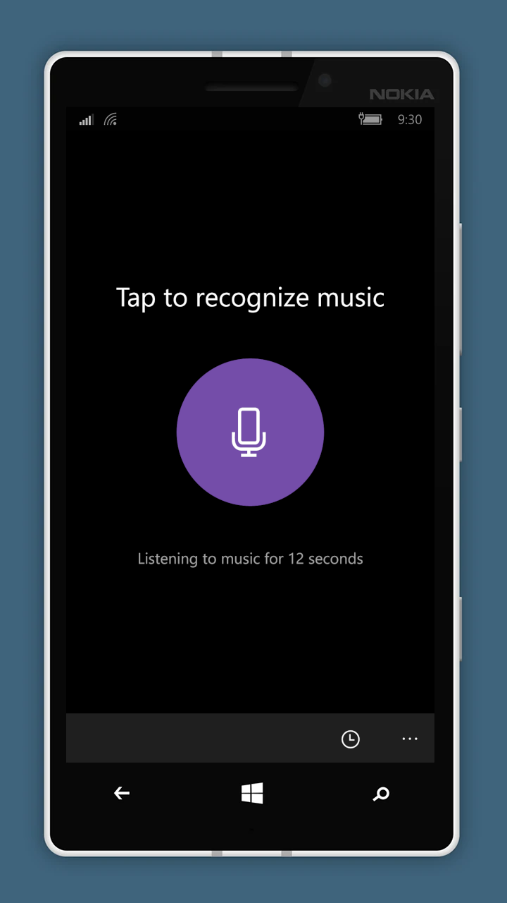

# Resonance
Resonance is a UWP port of [SongRec](https://github.com/marin-m/songrec), an open-source music-recognition client. It is built for Windows desktop and Windows 10 Mobile, with a minimum SDK of **10.0.14393.0**.

## Features
- One-shot recognition from a selected microphone or an audio file
- Recognition history, search, JSON backup/restore, and a manually sent offline queue
- English and Russian interface resources
- Microphone selection, signal diagnostics, and playback of the captured test segment

Resonance communicates with Shazam's recognition service using the protocol used by SongRec. The service endpoint is outside this project's control and may change. Resonance is an independent project and is not affiliated with or endorsed by Apple or Shazam.

## Build and deploy
Use Windows with Visual Studio and the UWP development workload, the **v141** C++ toolset, and Windows 10 SDK **10.0.14393.0**. Open `Resonance.sln` and deploy the `App` project from Visual Studio:
- Select **x64** (or **x86**) for desktop deployment
- Select **ARM** for Windows 10 Mobile

On a fresh checkout, create a local development certificate in the Visual Studio package-signing settings.

## License
Resonance is distributed under **GPL 3.0** license. See [LICENSE](LICENSE) and [THIRD-PARTY-NOTICES.txt](THIRD-PARTY-NOTICES.txt) for license text and third-party attributions.
